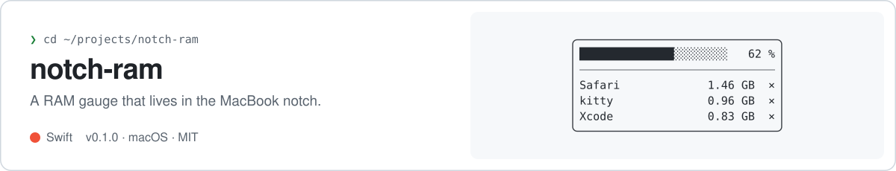
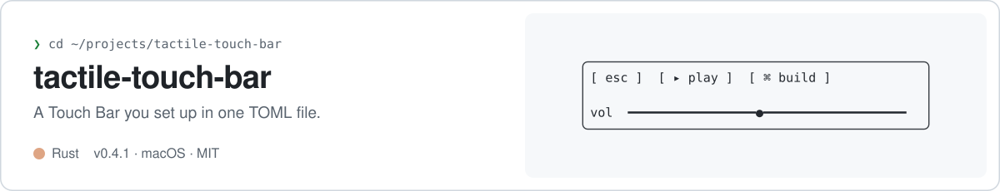
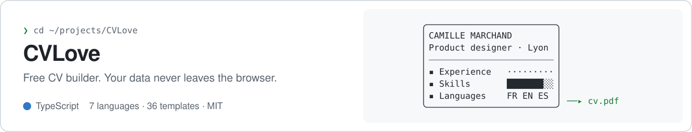

<picture>
  <source media="(prefers-color-scheme: dark)" srcset="assets/banner-dark.svg">
  
</picture>

I help small teams find the work that eats their week, then automate it:

- workflow audits that estimate the hours an automation would save
- automations plugged into the tools the team already uses
- AI project scoping: feasibility, technology choice, delivery
- business web apps such as sign-up portals, payment flows and back offices, on Next.js, Supabase and Vercel, with GDPR in mind

### Projects

<a href="https://github.com/lepalph/notch-ram"><picture><source media="(prefers-color-scheme: dark)" srcset="assets/notch-ram-dark.svg"></picture></a>

<a href="https://github.com/lepalph/tactile-touch-bar"><picture><source media="(prefers-color-scheme: dark)" srcset="assets/tactile-dark.svg"></picture></a>

<a href="https://github.com/lepalph/CVLove"><picture><source media="(prefers-color-scheme: dark)" srcset="assets/cvlove-dark.svg"></picture></a>

All three are free and MIT licensed. Try CVLove in your browser at <a href="https://cv-love-topaz.vercel.app">cv-love-topaz.vercel.app</a>.
