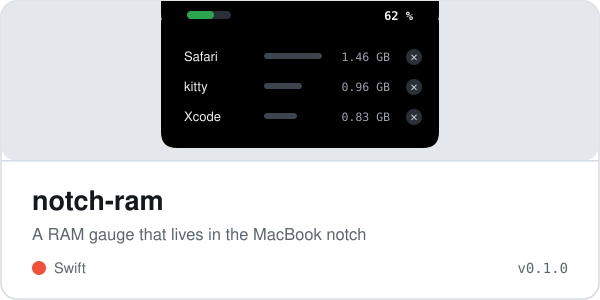
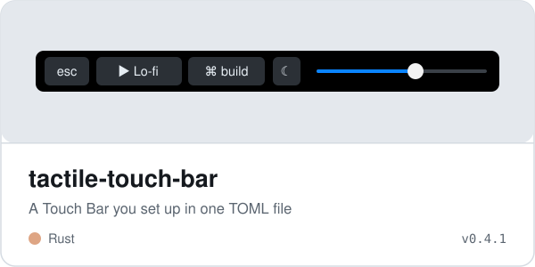

<picture>
  <source media="(prefers-color-scheme: dark)" srcset="assets/banner-b-dark.svg">
  
</picture>

I help small teams find the work that eats their week, then automate it. In practice that means:

- auditing a workflow and estimating the hours an automation would save
- plugging automations into the tools the team already uses
- scoping AI projects: feasibility, technology choice, delivery
- building business web apps such as sign-up portals, payment flows and back offices, on Next.js, Supabase and Vercel, with GDPR in mind

### Open source

  <a href="https://github.com/lepalph/notch-ram"><picture><source media="(prefers-color-scheme: dark)" srcset="assets/card-notch-ram-dark.svg"></picture></a>
  <a href="https://github.com/lepalph/tactile-touch-bar"><picture><source media="(prefers-color-scheme: dark)" srcset="assets/card-tactile-dark.svg"></picture></a>

